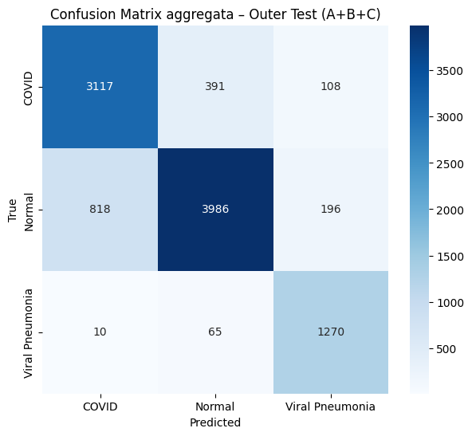

# Chest X-ray Classification with a CNN

Three-class classification of chest radiographs into **COVID**, **Normal** and **Viral Pneumonia**, using a convolutional neural network trained from scratch. This university project documents image preprocessing, class imbalance handling and hyperparameter selection within nested cross-validation.

The principal result is an outer-fold **macro F1-score of 0.8465 ± 0.0173**. All reported values are historical results saved in the original Google Colab experiment; they have not been reproduced in a new training run.

## Dataset

The images originate from the [COVID-19 Radiography Database](https://www.kaggle.com/datasets/tawsifurrahman/covid19-radiography-database). The experiment uses a local subset with the following distribution:

| Class | Images |
|---|---:|
| COVID | 3,616 |
| Normal | 5,000 |
| Viral Pneumonia | 1,345 |
| **Total** | **9,961** |

These counts describe the original experiment, not the entire public database. The selection procedure for the 5,000 Normal images was not recorded, so downloading the full database alone will not reconstruct the experimental subset. The Lung Opacity class is not included.

Images are not distributed in this repository. Obtain them separately and follow the dataset's terms and citation requirements. Labels are encoded in the order COVID, Normal, Viral Pneumonia.

## Image preprocessing and augmentation

Every image is decoded into one grayscale channel, resized to **224 × 224 pixels**, converted to floating point and divided by 255. A deterministic contrast adjustment of **1.15** is then applied, with intensities clipped to [0, 1]. The same deterministic preprocessing is used for training, validation and test images.

Training images additionally receive horizontal flips, random rotations with factor 0.03 (approximately **±10.8°**) and random zoom with factor 0.05. Validation and test images receive no random augmentation. Images are loaded through a `tf.data` pipeline with training-only shuffling, batching and prefetching.

## CNN architecture

The model is trained from scratch; no pretrained backbone or transfer learning is used.

| Stage | Operations | Dropout |
|---|---|---:|
| Input | 224 × 224 × 1 grayscale image | — |
| Block 1 | Conv2D, 32 filters → Batch Normalization → ReLU → MaxPooling | 0 |
| Block 2 | Conv2D, 64 filters → Batch Normalization → ReLU → MaxPooling | 0.1 |
| Block 3 | Conv2D, 128 filters → Batch Normalization → ReLU → MaxPooling | 0.2 |
| Block 4 | Conv2D, 256 filters → Batch Normalization → ReLU → MaxPooling | 0.3 |
| Feature aggregation | Global Average Pooling | 0.4 |
| Output | Dense, 3 units, float32 softmax | — |

All convolutions use 3 × 3 kernels, same padding and no bias. Training uses **AdamW**, weight decay **1e-5**, sparse categorical cross-entropy and balanced class weights computed from each fitting subset. The original mixed-float16 policy is retained, with float32 output probabilities.

## Nested cross-validation

The experiment uses **3 × 3 nested stratified cross-validation at image level**.

1. **Outer evaluation:** three shuffled stratified folds, with random state 42. Each outer-test fold is excluded from fitting and hyperparameter selection.
2. **Inner selection:** three shuffled stratified folds within the outer-training partition, with random state 123. Configurations are ranked by their mean validation macro F1-score.
3. **Final fitting:** after selecting hyperparameters, the outer-training partition is split into 80% fitting and 20% validation data using stratification and random state 7. A new CNN is trained on the fitting subset; validation controls early stopping and learning-rate scheduling.
4. **Outer testing:** the fitted model predicts the held-out outer-test fold. Predictions from all three outer tests are also combined for pooled evaluation.

The final model in each fold is therefore **not retrained on the complete outer-training partition**. The 20% validation subset remains reserved for training control.

### Hyperparameter search and training settings

| Setting | Inner fitting | Final fitting |
|---|---|---|
| Learning rates searched | 3e-4, 1e-4 | Selected by inner CV |
| Batch sizes searched | 16, 32 | Selected by inner CV |
| Maximum epochs | 7 | 25 |
| Early-stopping monitor | Validation loss | Validation loss |
| Early-stopping patience | 3 | 5 |
| Restore best weights | Yes | Yes |
| Learning-rate reduction patience | 1 | 2 |
| Learning-rate reduction factor | 0.5 | 0.5 |
| Minimum learning rate | 1e-6 | 1e-6 |

Four configurations are evaluated in each inner search. Across three outer folds, this entails 36 inner fits and three final fits: **39 model fits**. All saved outer folds selected learning rate **3e-4** and batch size **16**. Inner validation also controls training callbacks; its scores are selection scores rather than independent estimates of performance.

## Historical experimental results

### Outer-fold metrics

Macro averaging gives each class equal weight, helping interpret performance under class imbalance.

| Outer fold | Macro precision | Macro recall | Macro F1 |
|---|---:|---:|---:|
| A | 0.826854 | 0.848993 | 0.829281 |
| B | 0.830480 | 0.873292 | 0.846329 |
| C | 0.851738 | 0.881139 | 0.863966 |
| **Mean ± sample SD** | **0.8364 ± 0.0134** | **0.8678 ± 0.0168** | **0.8465 ± 0.0173** |

Standard deviation is computed across the three outer folds using `ddof=1`. It is not a confidence interval or evidence of generalisation to other institutions.

### Pooled outer-test evaluation

Combining the predictions from the three held-out test folds gives **9,961 predictions** and **accuracy 0.8406**. These pooled metrics differ from the arithmetic mean of fold-level metrics.

| Class | Precision | Recall | F1-score | Support |
|---|---:|---:|---:|---:|
| COVID | 0.7901 | 0.8620 | 0.8245 | 3,616 |
| Normal | 0.8973 | 0.7972 | 0.8443 | 5,000 |
| Viral Pneumonia | 0.8069 | 0.9442 | 0.8702 | 1,345 |
| **Macro average** | **0.8314** | **0.8678** | **0.8463** | **9,961** |

Normal has the lowest pooled recall, while Viral Pneumonia has the highest. These differences describe classification errors within this dataset; they do not establish clinical sensitivity in a prospective population.

### Aggregated confusion matrix



Rows represent true classes and columns predicted classes. This figure was extracted from the saved original output, without rerunning training. Its original title contains Italian text.


## Repository contents

| File | Purpose |
|---|---|
| [Chest_Xray_Classification.ipynb](Chest_Xray_Classification.ipynb) | Executable workflow and separately labelled historical results |
| [requirements.txt](requirements.txt) | Proposed dependency ranges |
| [VALIDATION.md](VALIDATION.md) | Changes, checks and unverified aspects |
| [PROVENANCE.md](PROVENANCE.md) | Source information for exported figures |
| `source_cell_*.png` | Original saved experimental figures |

The current GitHub layout stores figures in the repository root. Both README and notebook image links use these locations.

## How to run

Use a Python 3.10 or 3.11 environment. A GPU is recommended for the full nested procedure.

```bash
git clone https://github.com/ChiaraCenci/chest-xray-classification.git
cd chest-xray-classification
python -m venv .venv
# macOS / Linux:
source .venv/bin/activate
# Windows PowerShell instead:
# .venv\Scripts\Activate.ps1
pip install -r requirements.txt
jupyter lab
```

Arrange your separately downloaded experimental subset as follows:

```text
COVID-19_Radiography_Dataset/
├── COVID/images/
├── Normal/images/
└── Viral Pneumonia/images/
```

Set the environment variable `CHEST_XRAY_DATASET` to that directory before starting Jupyter, or change `DATASET_ROOT` in the notebook's first code cell. In Colab, uncomment the optional Drive mount instructions and set the same dataset-root variable. Then run the notebook cells in order.

Two transcription errors in the prepared notebook have been corrected: the LabelEncoder attribute is `le.classes_` and the class-weight function keyword is `classes=`. These corrections restore the original API calls without changing the experimental method. Historical metrics remain attributed to the original experiment; training has not been rerun.

## Reproducibility and scope

NumPy and TensorFlow seeds are set to 42; cross-validation and final split seeds are given above. The exact original package versions, image manifest and Normal-subset selection were not saved. Dependency ranges are proposed rather than an exact environment lock. Hardware, file enumeration order and unseeded augmentation can influence a fresh run.

The release was checked statically, but the complete training procedure was not rerun against the original dataset. Historical results should remain separate from metrics generated by any new execution or modified protocol.

## Limitations

- Splits operate at image level. Patient identifiers were not available for this audit, so patient-independent validation has not been demonstrated.
- Duplicate-content detection and patient overlap checks were not performed on the original images. Distinct file indices alone do not establish independent cases.
- Local subset selection and possible acquisition-source confounding limit conclusions about generalisation.
- Three outer folds provide a limited assessment of variability; their standard deviation does not quantify all uncertainty.
- There is no independent external, prospective or clinical validation. The model is a research and educational experiment and is not validated for clinical use.

## Data and code licensing

The dataset is obtained separately under its own terms. No code licence has been selected for this repository.
